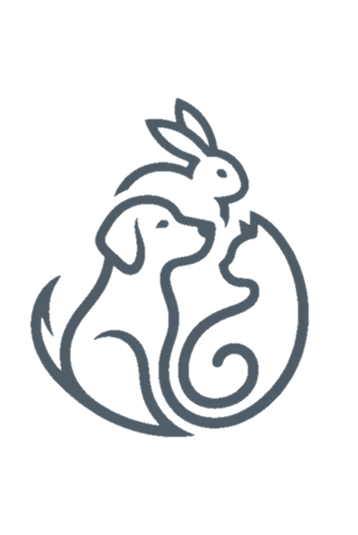
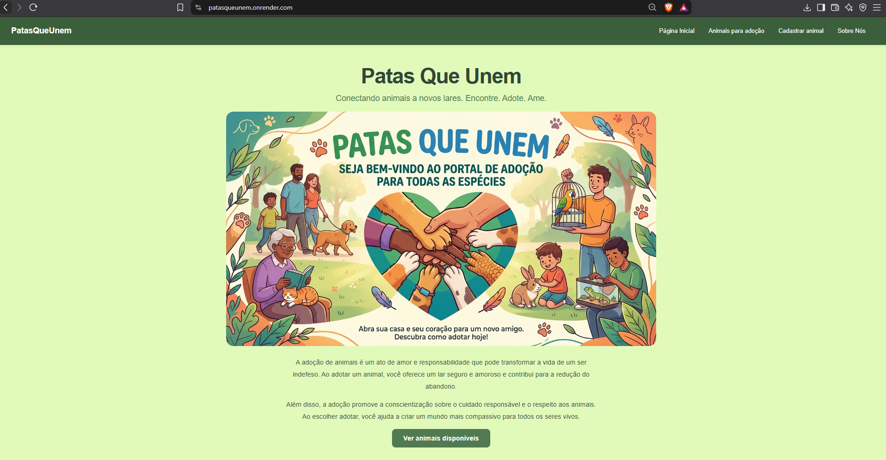
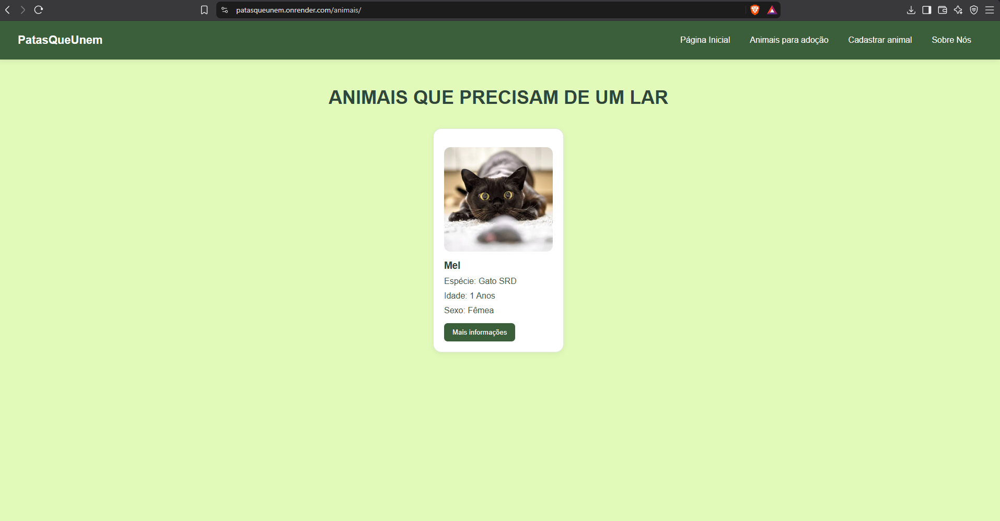
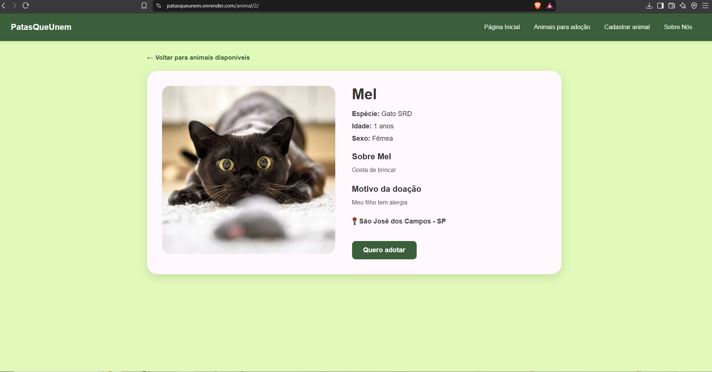
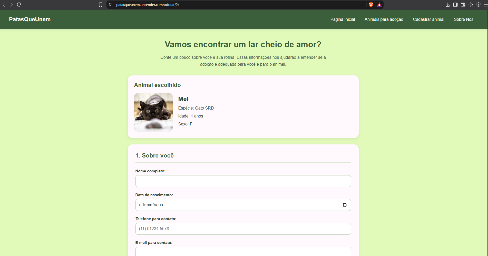
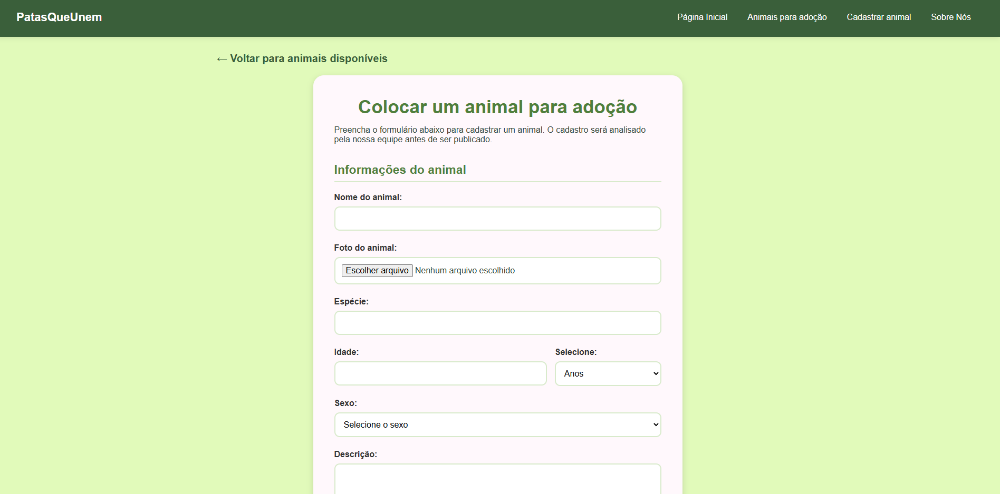
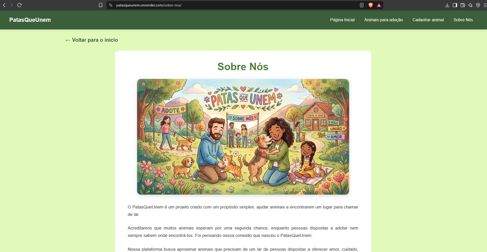

## 🐾 Patas que Unem

<div align="center">
  
</div>

**Conectando animais que precisam de um lar a pessoas que desejam adotar.**

**Acesse o site:** [https://patasqueunem.onrender.com/](https://patasqueunem.onrender.com/)

## 📌 Sobre o projeto

O **Patas que Unem** é uma aplicação web desenvolvida por estudantes do projeto integrador da UNIVESP.

A plataforma tem como objetivo facilitar a divulgação de animais disponíveis para adoção, apresentando suas informações e oferecendo um formulário para que pessoas interessadas possam demonstrar interesse na adoção.

O projeto reúne desenvolvimento web, integração com API externa, validação de dados, banco de dados relacional, armazenamento de imagens em nuvem e publicação de uma aplicação web.

## Funcionalidades

- Listagem de animais disponíveis para adoção.
- Página de detalhes com informações dos animais.
- Formulário para demonstrar interesse na adoção.
- Formulários para cadastro de animais e informações relacionadas à adoção.
- Validação de dados de entrada, incluindo telefone e e-mail.
- Preenchimento automático de endereço por meio da API ViaCEP.
- Upload e exibição de fotos dos animais.
- Painel administrativo para gerenciamento dos cadastros.
- Interface responsiva, adaptada para celulares, tablets e computadores.
- Página 404 personalizada.

## Tecnologias e ferramentas utilizadas

| Tecnologia ou ferramenta         | Aplicação no projeto                                                                                                                                |
|----------------------------------|-----------------------------------------------------------------------------------------------------------------------------------------------------|
| **Python**                       | Linguagem utilizada no desenvolvimento do sistema.                                                                                                  |
| **Django**                       | Framework responsável pela estrutura da aplicação, rotas, views, modelos, formulários e painel administrativo.                                      |
| **HTML**                         | Estrutura das páginas do site.                                                                                                                      |
| **CSS**                          | Estilização, cores, organização dos elementos e layout da interface.                                                                                |
| **JavaScript**                   | Interatividade e comportamentos dinâmicos da interface.                                                                                             |
| **PostgreSQL**                   | Banco de dados relacional utilizado na aplicação publicada, armazenando os dados dos animais e demais registros.                                    |
| **SQLite**                       | Banco de dados utilizado no ambiente local de desenvolvimento.                                                                                      |
| **API ViaCEP**                   | Consulta de endereços a partir do CEP, facilitando o preenchimento dos formulários.                                                                 |
| **Expressões regulares (Regex)** | Validação de formatos de dados, como telefone e e-mail.                                                                                             |
| **Cloudinary**                   | Armazenamento de imagens dos animais na nuvem, permitindo que os arquivos permaneçam disponíveis independentemente do disco temporário do servidor. |
| **Render**                       | Hospedagem da aplicação web e publicação do projeto na internet.                                                                                    |
| **Git e GitHub**                 | Controle de versão, histórico de alterações e armazenamento remoto do código-fonte.                                                                 |
| **WhiteNoise**                   | Servidor de arquivos estáticos da aplicação em produção.                                                                                            |
| **Gunicorn**                     | Servidor WSGI utilizado para executar a aplicação Django em produção.                                                                               |

## Como executar o projeto localmente

### Pré-requisitos

- Python instalado.
- Git instalado caso deseje clonar o repositório pelo terminal.

> **Observação sobre imagens:** o projeto utiliza o Cloudinary para armazenar as fotos dos animais na nuvem. Para testar localmente as funcionalidades de cadastro e upload de imagens, configure as credenciais do serviço nas variáveis de ambiente correspondentes. O SQLite é utilizado para armazenar os dados no ambiente local.

### 1. Clonar o repositório

```
git clone https://github.com/yazzi0101/PatasQueUnem.git
```

### 2. Entrar na pasta do projeto

```
cd PatasQueUnem
```

### 3. Criar e ativar o ambiente virtual

No Windows, usando PowerShell:

```
python -m venv .venv
.\.venv\Scripts\Activate.ps1
```

No Linux ou macOS:

```
python3 -m venv .venv
source .venv/bin/activate
```

### 4. Instalar as dependências

```
pip install -r requirements.txt
```

### 5. Configurar as variáveis de ambiente

Configure as variáveis necessárias para o ambiente local. As principais estão na tabela abaixo.

| Variável | Para que serve | Padrão local |
|---|---|---|
| `DEBUG` | `True` liga o modo de desenvolvimento; qualquer outro valor (use `False`) liga o modo de produção | `True` |
| `SECRET_KEY` | Chave secreta do Django | valor temporário embutido |
| `ALLOWED_HOSTS` | Hosts permitidos, separados por vírgula | `localhost,127.0.0.1` |
| `DATABASE_URL` | Conexão com o banco (PostgreSQL em produção) | SQLite local |
| `CLOUDINARY_CLOUD_NAME` | Nome da conta no Cloudinary | nenhum |
| `CLOUDINARY_API_KEY` | Chave de API do Cloudinary | nenhum |
| `CLOUDINARY_API_SECRET` | Segredo da API do Cloudinary | nenhum |

As variáveis são lidas pelo `settings.py`, mas não devem ser escritas nele. Defina no terminal antes de iniciar o servidor. No PowerShell, por exemplo: `$env:CLOUDINARY_CLOUD_NAME = "..."`. Elas valem apenas para o terminal aberto.

### 6. Aplicar as migrações

```
python manage.py migrate
```

### 7. Iniciar o servidor de desenvolvimento

```
python manage.py runserver
```

### 8. Acessar a aplicação

Abra o navegador em:

[http://127.0.0.1:8000/](http://127.0.0.1:8000/)

### Testando o modo de produção localmente

1. Desligue o debug no terminal atual (PowerShell):

   ```
   $env:DEBUG = "False"
   ```

2. Colete os arquivos estáticos:

   ```
   python manage.py collectstatic --noinput
   ```

3. Inicie o servidor:

   ```
   python manage.py runserver
   ```

> **Atenção:** com `DEBUG=False`, é preciso rodar o `collectstatic` novamente sempre que um arquivo estático for criado ou alterado. Sem isso, as páginas podem retornar **erro 500** ao carregar CSS, JavaScript ou imagens que não estão no manifesto de arquivos estáticos. Depois do teste, volte para `DEBUG=True` (ou abra um novo terminal) para continuar o desenvolvimento.

## Status do projeto

**Aplicação publicada e funcional, com melhorias contínuas.**

> **Nota sobre a hospedagem:** o projeto está hospedado no plano gratuito do Render. Por ser uma hospedagem gratuita, a disponibilidade contínua do site não é garantida e pode mudar conforme as condições da plataforma. Para conhecer o projeto, consulte também o código-fonte e as capturas de tela disponíveis nesse repositório.

Acesse: [https://patasqueunem.onrender.com/](https://patasqueunem.onrender.com/)

## Sistema

### Página inicial



### Animais disponíveis para adoção



### Detalhes do animal



### Formulário de interesse na adoção



### Cadastro de animais



### Sobre o projeto

