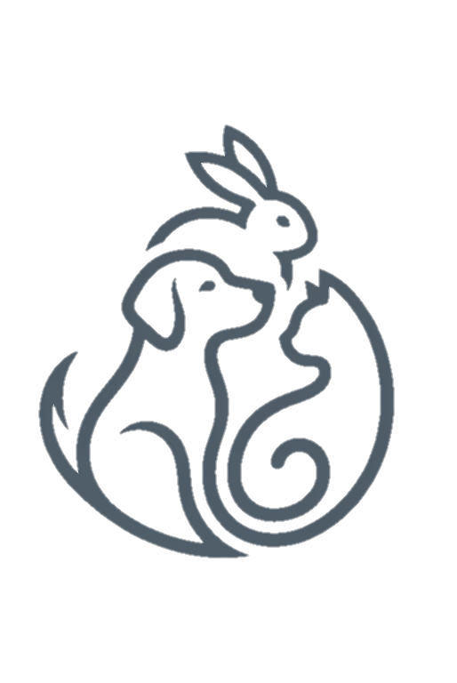
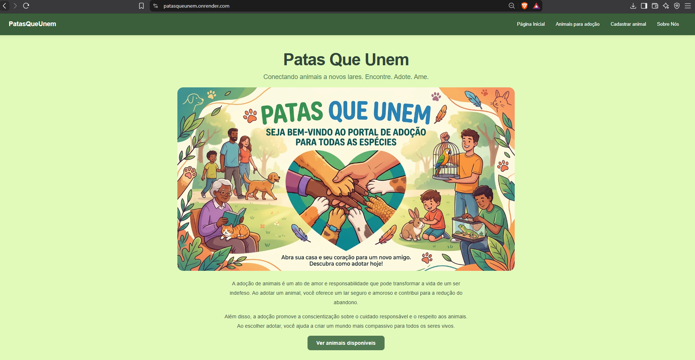
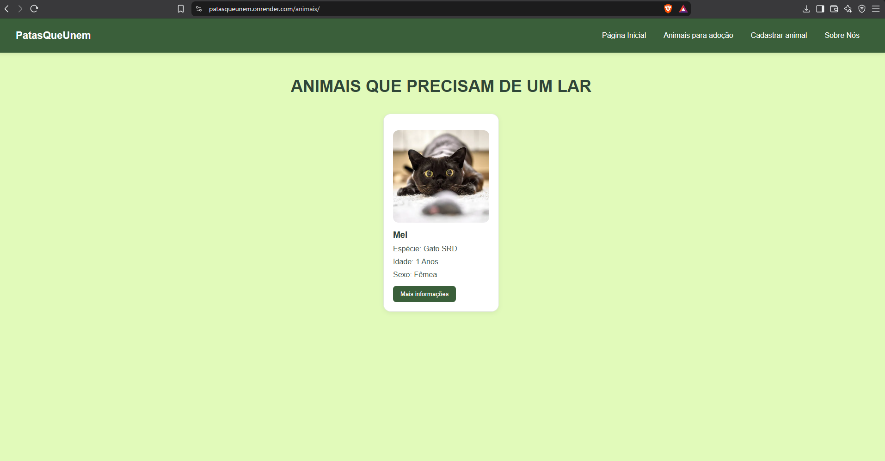
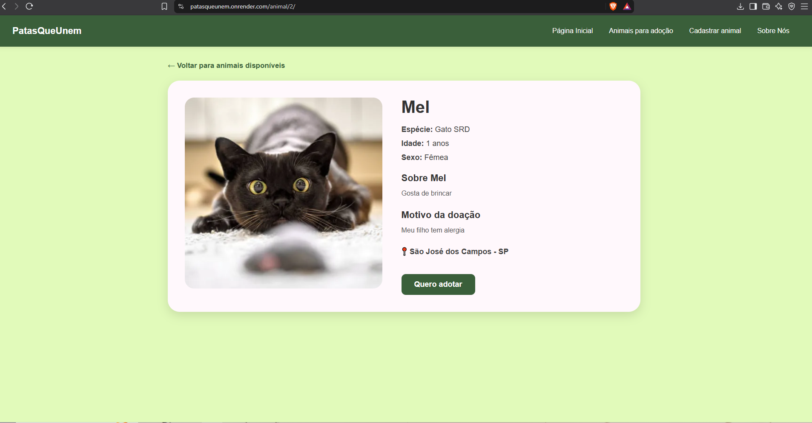
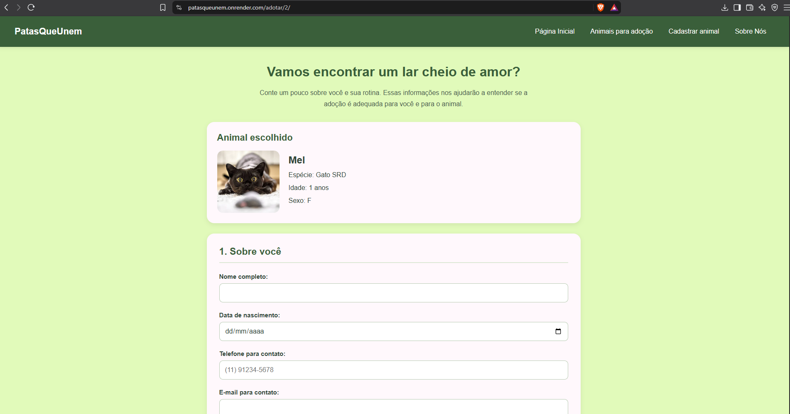
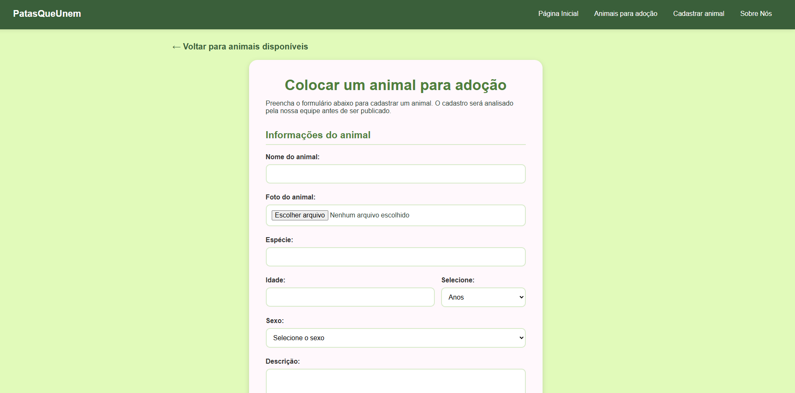
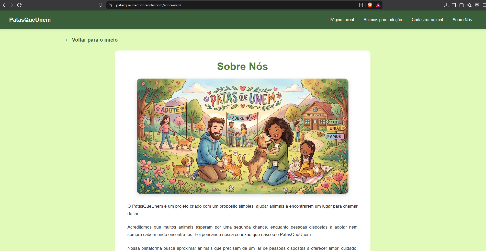

## 🐾 Patas que Unem

<div align="center">
  
</div>

**Conectando animais que precisam de um lar a pessoas que desejam adotar.**

**Acesse o site:** https://patasqueunem.onrender.com/

## 📌 Sobre o projeto

O **Patas que Unem** é uma aplicação web desenvolvida por estudantes do projeto integrador da UNIVESP.

A plataforma tem como objetivo facilitar a divulgação de animais disponíveis para adoção, apresentando suas informações e oferecendo um formulário para que pessoas interessadas possam demonstrar interesse na adoção.

O projeto reúne desenvolvimento web, integração com API externa, validação de dados, banco de dados relacional, armazenamento de imagens em nuvem e publicação de uma aplicação web.

## Funcionalidades

- Listagem de animais disponíveis para adoção.
- Página de detalhes com informações dos animais.
- Formulário para demonstrar interesse na adoção.
- Formulários para cadastro de animais e informações relacionadas à adoção.
- Validação de dados de entrada, incluindo telefone e e-mail.
- Preenchimento automático de endereço por meio da API ViaCEP.
- Upload e exibição de fotos dos animais.
- Painel administrativo para gerenciamento dos cadastros.
- Interface web adaptada para facilitar a navegação.

## Tecnologias e ferramentas utilizadas

| Tecnologia ou ferramenta | Aplicação no projeto |
|---|---|
| **Python** | Linguagem utilizada no desenvolvimento do sistema. |
| **Django** | Framework responsável pela estrutura da aplicação, rotas, views, modelos, formulários e painel administrativo. |
| **HTML** | Estrutura das páginas do site. |
| **CSS** | Estilização, cores, organização dos elementos e layout da interface. |
| **JavaScript** | Interatividade e comportamentos dinâmicos da interface. |
| **PostgreSQL** | Banco de dados relacional utilizado na aplicação publicada, armazenando os dados dos animais e demais registros. |
| **SQLite** | Banco de dados utilizado no ambiente local de desenvolvimento. |
| **API ViaCEP** | Consulta de endereços a partir do CEP, facilitando o preenchimento dos formulários. |
| **Expressões regulares (Regex)** | Validação de formatos de dados, como telefone e e-mail. |
| **Cloudinary** | Armazenamento de imagens dos animais na nuvem, permitindo que os arquivos permaneçam disponíveis independentemente do disco temporário do servidor. |
| **Render** | Hospedagem da aplicação web e publicação do projeto na internet. |
| **Git e GitHub** | Controle de versão, histórico de alterações e armazenamento remoto do código-fonte. |
| **WhiteNoise** | Servidor de arquivos estáticos da aplicação em produção. |
| **Gunicorn** | Servidor WSGI utilizado para executar a aplicação Django em produção. |

## Como executar o projeto localmente

### Pré-requisitos

- Python instalado.
- Git instalado caso deseje clonar o repositório pelo terminal.

Observação: Observação sobre imagens: o projeto utiliza o Cloudinary para armazenar as fotos dos animais na nuvem. Para testar localmente as funcionalidades de cadastro e upload de imagens, configure as credenciais do serviço nas variáveis de ambiente correspondentes. O SQLite é utilizado para armazenar os dados no ambiente local.

### 1. Clonar o repositório

```bash
git clone https://github.com/yazzi0101/PatasQueUnem.git
```

### 2. Entrar na pasta do projeto

```bash
cd PatasQueUnem
```

### 3. Criar e ativar o ambiente virtual

No Windows, usando PowerShell:

```powershell
python -m venv .venv
.\.venv\Scripts\Activate.ps1
```

No Linux ou macOS:

```bash
python3 -m venv .venv
source .venv/bin/activate
```

### 4. Instalar as dependências

```bash
pip install -r requirements.txt
```

### 5. Configurar as variáveis de ambiente

Configure as variáveis necessárias para o ambiente local, incluindo as credenciais do Cloudinary e, se aplicável, a conexão com o banco de dados.

### 6. Aplicar as migrações

```bash
python manage.py migrate
```

### 7. Iniciar o servidor de desenvolvimento

```bash
python manage.py runserver
```

### 8. Acessar a aplicação

Abra o navegador em:

http://127.0.0.1:8000/

> **Nota sobre a hospedagem:** o projeto está hospedado no plano gratuito do Render. Por ser uma hospedagem gratuita, a disponibilidade contínua do site não é garantida e pode mudar conforme as condições da plataforma. Para conhecer o projeto, consulte também o código-fonte e as capturas de tela disponíveis nesse repositório.

## Status do projeto

**Aplicação publicada e funcional, com melhorias contínuas.**

Acesse: https://patasqueunem.onrender.com/

## Sistema

### Página inicial



### Animais disponíveis para adoção



### Detalhes do animal



### Formulário de interesse na adoção



### Cadastro de animais



### Sobre o projeto


